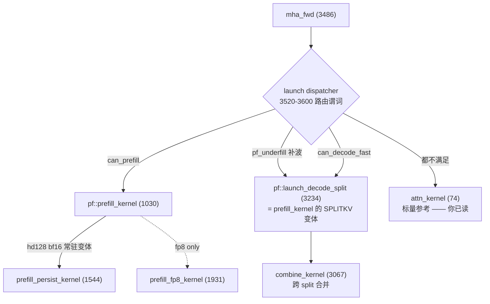

Ran terminal command:  wc -l kernels/fa3_hopper.cu kernels/fa4_blackwell.cu bench/*.py && echo '=== grep attn_kernel ===' && grep -rn "attn_kernel" --include=*.cu --include=*.py --include=*.md . | head -20
Tool execution failed with exit code 1


Ran terminal command:  cd /workspace/LeetCUDA/cuda_study_projects/flash-cuda; wc -l kernels/fa3_hopper.cu kernels/fa4_blackwell.cu bench/eval.py bench/scenarios.py; echo '=== attn_kernel ==='; grep -rn "attn_kernel" . --include=*.cu --include=*.py --include=*.md --include=*.sh | head -20


Read , lines 1 to 130

Ran terminal command:  cd /workspace/LeetCUDA/cuda_study_projects/flash-cuda; grep -n "^\(struct\|class\|template\|__global__\|__device__\|static\|inline\|void\|bool\|float\|int\|namespace\|#define\|// ==\|//==\|// ---\|////\)" kernels/fa3_hopper.cu | head -120


Read , lines 1 to 160


Read , lines 160 to 173


Ran terminal command:  cd /workspace/LeetCUDA/cuda_study_projects/flash-cuda; grep -n "^// =\|^// -\|^__global__\|^[a-z].*launch_\|^static .*launch\|^void \|^bool \|^int \|^template" kernels/fa3_hopper.cu | sed -n '1,200p'


Ran terminal command:  cd /workspace/LeetCUDA/cuda_study_projects/flash-cuda; sed -n '182,200p' kernels/fa3_hopper.cu; echo '=== dispatcher ==='; sed -n '3435,3520p' kernels/fa3_hopper.cu


Ran terminal command:  cd /workspace/LeetCUDA/cuda_study_projects/flash-cuda; sed -n '3520,3600p' kernels/fa3_hopper.cu


Ran terminal command:  cd /workspace/LeetCUDA/cuda_study_projects/flash-cuda; grep -n "softmax_stats\|pf_mask\|pf_softcap\|qk_gemm_g\|qk_rs_pv_g\|qk_pv_g\|pv_boxes\|pv_final_g\|rescale_o_g\|// \[*[A-Z0-9]*\]\|mbar_\|tma_box\|cp_async\|consumer_regs\|producer_regs\|lse\[" kernels/fa3_hopper.cu | awk -F: '$1>1028 && $1<1930' | head -80


Ran terminal command:  cd /workspace/LeetCUDA/cuda_study_projects/flash-cuda; sed -n '1484,1545p' kernels/fa3_hopper.cu


Ran terminal command:  cd /workspace/LeetCUDA/cuda_study_projects/flash-cuda; sed -n '258,300p' kernels/fa3_hopper.cu; echo '---- 600-675 ----'; sed -n '600,675p' kernels/fa3_hopper.cu


Ran terminal command:  cd /workspace/LeetCUDA/cuda_study_projects/flash-cuda; grep -n "add_argument\|def main" bench/eval.py | head -30

这份仓库的 `fa3_hopper.cu`（3672 行）**不是一个 kernel，是一组 kernel + 一个 dispatcher**。你读的 `attn_kernel`（74–180）是「数学标准答案」，所有快路径都和它同构。所以阅读策略是：**先立标准答案的对照表，再只读一条快路径的算法层，工程层整体跳过**。

---

## 0. 先看全局：谁在跑



**非 FP8 只需要跟三条**：`prefill_kernel` → （可选的 `prefill_persist_kernel`）→ `launch_decode_split` + `combine_kernel`。

**明确跳过**（约 1400 行，和算法无关）：
`673–931`（fp8 原语）、`846–931`（gather/transpose 搬数）、`1924–2433`（两个 fp8 kernel）、`2946–3065`（warp-per-row 的 `decode_kernel`，小 q 老路径）、`2433–2537`（CUtensorMap 编码）。

---

## 1. 第 0 步：地图与路由（约 40 分钟）

| 行 | 内容 | 读法 |
|---|---|---|
| `182–190` | FAST PATH 1 的 banner 注释 | 作者自述设计意图，先读 |
| `194–198` | `CTA_M=128, CTA_N=128, HD=128, WG=128, WS_STAGES=3` | 记住这 5 个数，后面全是它们的组合 |
| `3435–3475` | `launch()`：填 `Params`，**当前只调 `attn_kernel`** | 确认标量路径是唯一无条件正确路径 |
| `3520–3600` | `can_prefill / can_decode / can_decode_fast / pf_underfill` 谓词 | **只看谓词，不看宏展开**。搞清「什么 shape 进哪条路」 |
| `3600–3672` | 两条 `PF_RT / DS_DEC` 分派宏 + op 注册 | 扫一眼即可 |

读完你应该能回答：*q=1,k=8192,hd=128,bf16,GQA8* 走哪条？→ `can_decode_fast` → `launch_decode_split`。

---

## 2. 第 1 步：算法原语（半天，**这是最该精读的部分**）

`namespace pf` 里前面这 ~300 行才是「算法」，其余都是搬运。

| 行 | 函数 | 算法内容 |
|---|---|---|
| **`264–296`** | `softmax_stats` ★★★ | **在线 softmax 的全部**：行内 4 路 `fmaxf` → `quad_max`（4 lane 归约）→ 更新 `m_r[r]` → 返回 `scale_f = exp2((m_prev−m_cur)*s2)` → 原地把 `s` 改写成 `P` → 累加 `l_r[r]` |
| **`297–320`** | `pf_mask` ★★ | causal + klen 掩码：`col0/qlo/qhi` 三个量就是 2D tile 的行列界限，含「整块可见」快速跳出 |
| **`321–349`** | `pf_mask_win` ★★ | 加滑窗 + attention_chunk 的版本（`EXTRA` 模板开关） |
| `350–362` | `fast_tanh` / `pf_softcap` | softcap，`2*sigmoid(2x)-1` 手写 |
| **`607–616`** | `rescale_o_g` | `acc_o` 按 `sc[0]/sc[1]` 缩放（两行） |
| `232–241` | `quad_max` / `quad_sum` | 4-lane `__shfl_xor` 归约，说明「一个 quad 负责一行」 |

### 关键：把它和 `attn_kernel` 逐条对上

| 标量版（74–180） | 快路径 | 差异 |
|---|---|---|
| `m`, `l` 两个标量 | `m_r[2]`, `l_r[2]` | 每线程管 2 行（`r=0/1`），一行由 4 lane（quad）分摊 128 列 |
| `for j < klen` 逐 key | 外层 `n_cnt` 逐 **CN=128 key 的 tile** | 同一循环，只是粗粒度化 |
| `expf` / `__expf` | `ex2_approx`（`ex2.approx.ftz.f32`） | 全部改成 `exp2`，所以 scale 里预乘 `log2(e)`（`s2 = scale*log2e`） |
| `masked` 判断 | `pf_mask(s, n_lo*CN, qpos_lo, qpos_hi, ...)` | 标量版逐元素判断 → tile 版算边界后填 `-INFINITY` |
| `lse = m*scale + log(l)`（约 175 行） | `1484–1518` `lse_v = mr*sc_eff + __logf(l_r[r])` | 完全一致 |
| `acc/dv` 直接写 O | `pack_2x<TC>` 两列打包写 `uint32_t` | 纯向量化 |

**这一步做完，你就已经理解全部算法了**，后面只是 2D 索引和流水。

---

## 3. 第 2 步：prefill 主循环（1 天，只读 consumer）

看 `prefill_kernel`（1030–1525），**producer 段（1153–1390）第一遍直接跳过**。

| 行 | 内容 | 要点 |
|---|---|---|
| `1030–1100` | 模板参数 / `CM/CN` 推导 / SPLITKV 判定 | 只记 `CM=128` 的 M 被两个 consumer WG 各分 64 行 |
| `1395–1420` | consumer 初始化、寄存器声明 | 建立寄存器状态机（下表） |
| `1422–1436` | **首块**：`qk_gemm_g` → `pf_mask` → `softmax_stats(nb=0)` | `nb==0` 是「无 rescale」的特殊分支 |
| `1440–1478` | **主循环**（ping-pong） | 见下方顺序 |
| `1480–1483` | 尾块 `pv_final_g` | 补最后一个 PV |
| `1484–1518` | epilogue | `quad_sum(l)` → `inv=1/l` → LSE → 按 `num_splits` 写 partial 或 final |

主循环的**算法顺序**（务必逐行对，这里是 FA3 的精髓）：

```
qk_pv_g(...)        // QK[i+1] 与 PV[i] 背靠背发射，都留在飞行中
pf_softcap / pf_mask // 对 s 做 softcap、causal 掩码
softmax_stats(r=0)  // 得到 sc[0]，且 s 原地变成 P，l_r 累加
softmax_stats(r=1)  // 得到 sc[1]
rescale_o_g(acc_o, sc)   // ← rescale 在 PV 之后！(1473 行)
```

`rescale_o_g` 在 PV 之后调用，就是官方 FA3 的 `RescaleOBeforeGemm=false`（见 `mainloop_fwd_sm90_tma_gmma_ws.hpp:1202`）。`qk_rs_pv_g`（644）是提前 rescale 的旧版本，注释 656–665 明说了为什么放弃它 —— **这段注释是理解「为什么 rescale 位置会影响 tensor 流水」的最好材料**。

### 每线程寄存器状态机

| 名字 | 大小（CN=128, HD=HDV=128） | 含义 |
|---|---|---|
| `s[CN/2]` = `s[64]` | 64 fp32 | 2 行 × 32 列 的 S，softmax 后原地变成 P |
| `acc_o[HDV/2]` = `acc_o[64]` | 64 fp32 | 2 行 × 32 列 的 O 累加器 |
| `m_r[2]`, `l_r[2]`, `sc[2]` | 6 fp32 | 每行一个 max / sum / rescale |
| `P[CN/4]` = `P[32]` | 32 u32 | P 打包成 bf16x2 供 PV 的 wgmma A 操作数（RS 形式） |

**只盯这 5 个数组就够**；`sQ_wg / sK_a / sV_a / stK_bytes` 全是地址算术。

---

## 4. 第 3 步：流水与分工（可选，1 小时，70% 可跳）

只有当你需要解释「为什么 K 在 QK 后就能释放、V 必须等 PV 后」时才回来看：

- `1129–1146` mbarrier 布局（`full/empty/full_v/empty_v/barQ`）
- `1226–1275` TMA 生产（`mbar_expect_tx` + `tma_box`）
- `1431 / 1462 / 1469` consumer 侧的 `mbar_arrive(&empty[...])`：**这三行就是 ring 的正确性边界**
- `1526–1542` `prefill_persist_kernel` 的 banner 注释 → 读注释即可，代码（1544–1924）是「ring 不重置、Q 单缓冲」的工程变体，算法与 `prefill_kernel` 完全相同

---

## 5. 第 4 步：split-KV + combine（半天）

| 行 | 内容 |
|---|---|
| `1100–1133` | `SPLITKV` 判定与独立 K/V barrier（因为 V 要和 K 分开释放） |
| `1489–1518` | `num_splits>1` 时写 **已归一化的** partial O 与 partial LSE |
| `3234–3366` | `launch_decode_split`：split 数怎么按 SM 数与 klen 定 |
| **`3066–3125`** | `combine_kernel` ★：跨 split 合并公式 |

combine 的数学（和 FA3 `flash_fwd_combine_kernel.h` 一致）：

$$O=\frac{\sum_s O_s\,e^{LSE_s-LSE_\max}}{\sum_s e^{LSE_s-LSE_\max}},\qquad LSE=LSE_\max+\log\sum_s e^{LSE_s-LSE_\max}$$

注意本仓库的 partial 是**已归一化**的，所以合并是对 `O_s` 加权平均，而不是再除一次分母 —— 容易看错。

---

## 6. 第 5 步：和官方 FA3 对照（可选）

| 官方 `hopper/`（在 `hopper`） | 本仓库 |
|---|---|
| `softmax.h::Softmax::max_get_scale/online_softmax/finalize` | `pf::softmax_stats`（264）+ epilogue（1484） |
| `mask.h::Mask::apply` | `pf::pf_mask / pf_mask_win`（297/321） |
| `mainloop_fwd_sm90_tma_gmma_ws.hpp::mma()` 1163–1245 | `prefill_kernel` 1422–1478 |
| `epilogue_fwd.hpp::store()` | 1484–1518 |
| `flash_fwd_combine_kernel.h` | `combine_kernel`（3066） |
| `block.h::get_n_block_min_max` | `launch_prefill_t`（2537）里的 `n_cnt` 区间计算 |

差异只有两处值得记：**本仓库没有 `Check_inf` 的 `-inf - -inf` 特判**（它用 `(m==-INFINITY)?0:` 代替，264–286），以及**没有 `LargeHeadDimV` 的双 WG 拆分**（`HD==192,HDV==128` 用另一种 box 划分绕过）。

---

## 7. 怎么验证自己读懂了

用 `eval.py` 跑单场景对拍，改一行看 `max diff`：

```
python bench/eval.py --target _vllm_fa3_C --cand <your_build> --set claim --configs <scenario>
```

三个自检动作（比通读有效得多）：
1. 把 `rescale_o_g` 从 1473 挪到 `softmax_stats` 之前（即改用 `qk_rs_pv_g`），确认结果不变、性能变化 —— 验证你理解了 rescale 的两种位置。
2. 把 `softmax_stats` 里的 `scale_f` 强制设 1.0，确认只有 causal + 非零 softcap 的用例出错 —— 验证你理解了 rescale 只在 `m` 变化时生效。
3. 把 `pf_mask` 的 `col0` 改成 `0`，确认只有 causal/local 场景错 —— 验证你理解了 tile 行列界限。

---

## 建议的时间安排

| 半天 | 内容 |
|---|---|
| 1 | 第 0 步地图 + 第 1 步算法原语（对照 `attn_kernel` 做表） |
| 2 | 第 2 步 prefill 主循环 + epilogue |
| 3 | 第 4 步 split-KV + combine（+ 顺手读 `prefill_persist_kernel` 注释） |
| 4 | 第 5 步与官方 FA3 对照 + 三个自检实验 |

另外 `plans` 里有作者当时的实现计划文档，读 `prefill_kernel` 前扫一遍能省很多猜测，但注意里面的行号已过期（例如它说 decode 是死代码，现在 3234 的 decode 已经接进路由了）。

要不要我把上面第 2 节的 `attn_kernel ↔ pf 原语` 对照表整理成 `docs/fa3_hopper_reading_map.md` 落到仓库里，方便你边读边勾?